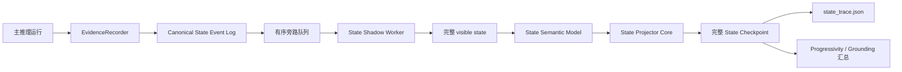

# State interaction 完整状态旁路实施计划

状态：第一版已实施，旁路默认关闭，需要在 metrics 配置中设置 `state_sidecar: online_full` 才会启用。

本计划只处理 `state_interaction` 指标。目标是在主推理运行期间异步构建完整的对话状态，并保存每个事件后的完整状态快照，使评分阶段可以直接读取已保存的状态轨迹，避免再次串行调用语义模型。

本计划不引入相关状态筛选、不引入状态 patch、不把状态评分写入 Agent 的决策链，也不增加运行时验收器。旁路只观察、解释、更新和保存状态；主推理结果与主 reward 不依赖旁路是否成功。

## 1. 当前状态和目标

当前流程是：

```text
主推理
  └─ 保存 trajectory、工具证据、音频证据和状态事件

评分阶段
  └─ 读取 evidence
       └─ 按事件顺序调用 State semantic model
            └─ 更新 DialogueState
                 └─ 写 state_trace.json
```

目标流程是：

```text
主推理运行
  ├─ EvidenceRecorder 记录 canonical state event
  └─ StateShadowWorker 异步消费 event
       ├─ 读取完整 state_before
       ├─ 调用语义模型
       ├─ 按事件顺序更新 DialogueState
       ├─ 保存完整 state_after
       └─ 保存窗口变化和 state-use opportunities

评分阶段
  └─ 直接读取完整 sidecar trace
       └─ 汇总 Progressivity 和 Grounding
```

单题内部的状态更新仍然按顺序进行。旁路的收益来自它和主推理重叠运行，而不是把有因果依赖的事件强行并行化。

## 2. 状态边界

第一版使用完整的 evaluator-visible state：

```text
goals
agenda
facts
constraints
operations
uncertainty
dialogue
```

当前状态模型已经移除了 `claims`。Agent 的原始说法保留在 `dialogue`，其是否正确使用状态由 `uses` 和 `opportunities` 表达。

旁路不把隐藏任务答案、私有参考答案或未来工具结果加入 Agent 可见状态。每个事件的模型输入必须由该事件发生之前的状态生成。

完整状态和模型输入使用同一份状态对象：

```text
完整 DialogueState
  ├─ 用于 checkpoint、恢复和审计
  └─ state.visible(viewer) 用于当前模型输入
```

本阶段不做 compact visible state。每次模型请求都使用完整的可见状态，先保证语义和回放结果一致，再考虑输入压缩。

## 3. 总体架构



主要组件：

| 组件 | 职责 |
|---|---|
| `EvidenceRecorder` | 在已有事件边界复制并发布事件，不调用模型 |
| Canonical event log | 保存唯一的事件顺序和事件内容 |
| `StateShadowWorker` | 单题内按 sequence 顺序消费事件 |
| `StateSemanticInterpreter` | 解释当前事件，输出 `Interpretation` |
| `State Projector Core` | 根据解释结果更新状态和窗口 |
| `CheckpointStore` | 原子保存每一步完整状态 |
| State trace reader | 评分阶段读取 sidecar 结果 |
| 离线 fallback | 没有完整 sidecar 时沿用旧的 evidence replay |

## 4. Canonical state event

旁路不能自己重新猜测消息和工具的因果顺序。它应当消费和 evidence 使用相同的 canonical event stream。

事件类型保持当前定义：

```text
user_turn
agent_turn
tool_requested
tool_completed
tool_delivered
backend_observation
```

每个事件至少包含：

```json
{
  "event_id": "agent:1102",
  "kind": "agent_turn",
  "role": "agent",
  "sequence": 13,
  "timestamp": 123.4,
  "content": "...",
  "visible_to": ["agent"],
  "source": "tau-state-events/2",
  "metadata": {"incomplete": false}
}
```

事件来源规则：

- 文本用户或 Agent 消息在真正交付时发布；
- 工具请求在调用发起时发布；
- 工具完成在环境返回时发布；
- 工具结果在对 Agent 可见时发布；
- 语音事件在转写或交付内容确定后发布；
- 后台生命周期事件作为 `backend_observation` 发布，不伪造成 Agent 已知事实。

`EvidenceRecorder.state_event()` 已经提供事件记录入口。实现时让旁路订阅该入口，不在旁路中再次读取 trajectory 并重建另一套事件序列。

## 5. Projector Core 拆分

当前 [projector.py](../src/tau2/diagnostics/state/projector.py) 的 `project_state()` 同时负责读取事件、调用模型、修改状态、创建窗口和保存版本。需要将它拆成可复用的单事件核心：

```python
def initialize_state(task=None) -> DialogueState:
    ...


def apply_event(
    state: DialogueState,
    event: DialogueEvent,
    interpretation: Interpretation,
    adapter: DomainAdapter,
) -> StateStepResult:
    ...
```

`StateStepResult` 至少包含：

```python
class StateStepResult:
    state_before: DialogueState
    interpretation: Interpretation
    state_after: DialogueState
    transition: StateTransition
```

`apply_event()` 负责保留现有状态语义：用户 updates、Agent uses、fulfills、advances、regresses、工具事件、后台观察、uncertainty、dialogue 和窗口变化。

现有离线 `project_state()` 调用相同的 `apply_event()`。旁路 worker 也调用相同函数，避免在线和离线出现两套状态迁移逻辑。

## 6. StateShadowWorker

每个 trial 创建一个独立的 `StateShadowWorker`，拥有自己的 state、ordered queue、semantic interpreter、domain adapter 和 checkpoint store。

处理循环：

```text
取出 event N
  ↓
确认 sequence == next_sequence
  ↓
保存 state_before
  ↓
调用 state.visible(viewer)
  ↓
调用 StateSemanticInterpreter
  ↓
调用 apply_event()
  ↓
保存 state_after 和 transition
  ↓
提交 sequence N
  ↓
处理 event N+1
```

队列顺序处理：

- `sequence == next_sequence`：立即处理；
- `sequence > next_sequence`：暂存在 pending buffer；
- `sequence < next_sequence`：视为重复事件，不重复处理。

旁路不得在 `EvidenceRecorder` 的锁内调用模型。事件在锁内复制，释放锁后再放入队列。

## 7. 完整 checkpoint

第一版每个事件保存完整状态，不使用增量 patch：

```text
diagnostics/
├── evidence/
├── state_sidecar/
│   ├── events.jsonl
│   ├── checkpoints/
│   │   ├── 000000.json
│   │   ├── 000001.json
│   │   └── ...
│   ├── status.json
│   └── state_trace.json
└── latest.json
```

单步 checkpoint：

```json
{
  "sequence": 13,
  "event_id": "agent:1102",
  "event": {},
  "state_before": {},
  "interpretation": {},
  "state_after": {},
  "transition": {},
  "status": "complete"
}
```

`status.json`：

```json
{
  "received_sequence": 23,
  "committed_sequence": 23,
  "status": "complete",
  "failed_events": [],
  "model_requests": 23
}
```

写文件使用临时文件替换，避免进程中断留下半个 JSON。刚才的示例只有 25 个状态版本，完整保存约几百 KB，第一版可以接受。

## 8. 运行生命周期

在 [simulation.py](../src/tau2/runner/simulation.py) 的 `run_simulation()` 中配置 recorder 后启动旁路：

```text
1. 创建 EvidenceRecorder
2. 创建 StateShadowWorker
3. 将 worker 注册到 recorder
4. 开始主推理
5. recorder 发布 canonical state events
6. worker 异步消费事件
7. 主推理结束
8. recorder 停止发布事件
9. worker drain 剩余事件
10. 保存 sidecar status 和 state_trace
11. 主流程继续保存 simulation result
```

配置建议：

```yaml
state_interaction:
  sidecar: online_full
  queue_size: 256
  drain_timeout_seconds: 900
```

`online_full` 表示完整状态视图，不提供 compact view 和相关状态筛选。

## 9. 失败和积压处理

旁路错误不应影响主推理：

- 语义模型失败：保存 `failed` 或 `uncertain` checkpoint，状态沿用上一版本；
- 事件不完整：保存 `incomplete` checkpoint，不猜测内容；
- worker 崩溃：主推理继续，旁路状态标记为 `incomplete`；
- 队列积压：主推理继续，worker 按 sequence 排空；
- drain 超时：保留已提交 checkpoint，并允许后续离线补算。

不增加运行时验收器，不因为旁路 partial 自动拒绝 trajectory，也不启动额外模型检查旁路是否正确。旁路只记录自身状态，最终是否可评分由已有的 `state_interaction` 结果字段表达。

## 10. 评分阶段读取

当前 `state_interaction` 会调用 `project_state()`。改为：

```text
存在完整 online_full trace
  → 直接读取 state_trace
  → 本地汇总 Progressivity 和 Grounding

没有完整 sidecar trace
  → 使用旧的 evidence replay fallback
```

读取时只做轻量身份检查：`simulation_id`、`task_id`、`event_count`、`last_sequence`、`projector_version` 和 `trace_status`。不重新执行完整状态回放，不重新调用语义模型，不增加二次审计流程。

## 11. 兼容性

同时支持：

```text
旧结果：没有 sidecar，走离线 replay
新结果：有完整 sidecar，直接读取
部分结果：sidecar 不完整，允许显式离线补算
```

已有 `state_trace.json` 的版本号、`projector_version` 和 `state_interaction` 版本要保留。在线 trace 与离线 replay 使用同一个 projector core。

## 12. 轻量验证范围

只验证机制，不做长时间全量评测：

1. 小 fixture 按顺序处理 3–5 个事件；
2. 每个事件产生一个完整 checkpoint；
3. 乱序事件等待正确 sequence；
4. 旁路模型失败时主流程仍可结束；
5. checkpoint 可以被 `state_interaction` 直接读取；
6. online projector 和离线 projector 对同一 fixture 得到相同最终状态。

不增加全 benchmark 验收、额外 judge、运行时双版本评分、评测热路径审计器或自动拒绝主推理结果的检查。

## 13. 实施顺序

### 阶段 1：拆分 projector core

- 从 `project_state()` 提取 `apply_event()`；
- 保持现有离线回放结果；
- 增加小 fixture parity 测试。

### 阶段 2：增加完整 checkpoint store

- 定义 checkpoint schema；
- 实现原子写入；
- 保存完整 `state_before` 和 `state_after`；
- 保存旁路 status。

### 阶段 3：接入 StateShadowWorker

- 从 EvidenceRecorder 发布事件；
- worker 单题内有序消费；
- 旁路不阻塞主推理；
- 结束时 drain 并写 trace。

### 阶段 4：评分优先读取 sidecar

- 完整 sidecar 直接本地汇总；
- 没有 sidecar 时使用现有 replay；
- partial sidecar 保留明确状态，不覆盖主 reward。

### 阶段 5：观察后再优化

- 统计旁路是否能在主推理结束前追平；
- 统计队列积压和模型调用失败；
- 再决定是否需要 compact view、patch 存储或模型请求优化。

## 14. 完成标准

```text
主推理阶段可以异步产生完整 state checkpoints
单题事件顺序和可见状态语义保持不变
评分阶段可以直接读取完整 sidecar trace
旧结果仍能用离线 replay
旁路失败不影响主推理和主 reward
没有新增运行时验收或额外审查模型
```
